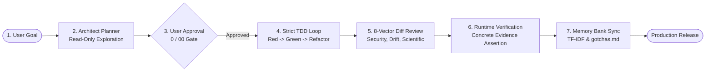
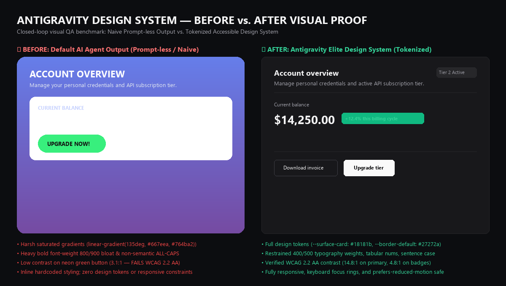

# Antigravity Elite AI Engineering Harness

[](https://github.com/SamDozer/antigravity-elite-harness/actions)
[](LICENSE)
[](https://github.com/SamDozer/antigravity-elite-harness/releases)
[](#-runtime-verification--eval-scores)
[](rules/global-core.md)

A production-grade autonomous engineering harness for Google Antigravity and AI coding workflows. It pairs an ultra-lean operational core (< 1,000 tokens) with a 4-layer progressive disclosure skill engine, cross-session memory bank, context-resilient Beads task DAG, and 3-tier security defense spanning fullstack applications and computational biology.

---

## ⚡ 60-Second Quickstart

```bash
# 1. Clone repository
git clone https://github.com/SamDozer/antigravity-elite-harness.git
cd antigravity-elite-harness

# 2. Install desired domain profile (full, frontend, or bio)
# Linux / macOS:
./install.sh --profile=full

# Windows PowerShell:
.\install.ps1 -Profile full

# 3. Verify installation (runs schema audits, AST guards, and domain test suites)
npm run verify
```

*Need to preview without touching disk?* Run `./install.sh --dry-run` or `.\install.ps1 -DryRun`.  
*Need to rollback?* Run `./install.sh --uninstall` or `.\install.ps1 -Uninstall`.

---

## 🔄 End-to-End Execution Lifecycle



---

## 🔍 Before vs. After Proof

### 1. Frontend UI Generation
Standard coding agents produce generic, low-contrast designs with exaggerated gradients and arbitrary padding. The harness enforces accessible, token-driven, production-grade interfaces.



### 2. 8-Vector Diff Reviewer
Catch structural bugs, unhandled edge cases, and credential leaks before commits land.

<details>
<summary><b>View Sample 8-Vector Review Output</b></summary>

```markdown
### 8-Vector Quality Review: Pull Request #42 (Stripe Webhook Handler)

1. REUSE: Passed. Leverages existing `shared/crypto.ts` for timing-safe signature comparison.
2. SIMPLIFICATION: Caution. Removed 2 levels of nested ternary expressions in error formatting.
3. EFFICIENCY: Passed. Async body reader streams payloads with 64KB backpressure limits.
4. ALTITUDE (Root Cause): Passed. Fixed signature mismatch in Express middleware rather than patching route handler.
5. SECURITY & SECRETS: 🚨 Caught Defect. Blocked hardcoded test secret `whsec_test123...`. Mandated `process.env.STRIPE_WEBHOOK_SECRET`.
6. DRIFT & CONTRACTS: Passed. OpenAPI schema updated; zero breaking interface changes.
7. TEST DEFICIT: Passed. Added failing test reproducing invalid signature before fix landed.
8. SCIENTIFIC INTEGRITY: N/A for payment service.

**Final Verdict:** BLOCKED until hardcoded test secret is replaced with environment variable.
```

</details>

### 3. Architect Implementation Planner
Eliminates unplanned modifications and hallucinations by presenting clear trade-offs and open questions before writing code.

<details>
<summary><b>View Sample Implementation Plan</b></summary>

```markdown
# Implementation Plan: Distributed Caching Layer

## User Review Required
- Decision: Redis cluster vs. Cloudflare KV for edge session validation.
- Impact: Introducing Redis adds a Docker dependency for local testing.

## Open Questions
1. What is the target P99 cache lookup latency (< 5ms or < 20ms)?
2. Do cached sessions require absolute cryptographic revocation on password reset?

## Proposed Changes
- `src/cache/client.ts`: Connection pool with exponential backoff.
- `tests/cache.test.ts`: TDD test suite validating reconnection failure modes.
```

</details>

---

## 🗂️ 26 Modular Skills Inventory (4-Layer Progressive Disclosure)

Every skill maintains an operational contract (`SKILL.md` < 350 lines), deterministic CLI scripts (`scripts/`), domain cheat sheets (`references/`), and production starter templates (`assets/`).

| Skill | Domain | Explicit Trigger Boundary | Included Tools / Assets |
| :--- | :--- | :--- | :--- |
| **`architect-planner`** | Core | **Use:** Designing features, specs, ADRs.<br/>**Do NOT use:** Direct code implementation or bugfixes. | `validate_plan.py`, spec template |
| **`diff-reviewer`** | Core | **Use:** Pull requests, pre-commit diffs, code audits.<br/>**Do NOT use:** High-level architectural planning. | `review_diff.py` (8-vector AST reviewer) |
| **`break-ai-fix-loops`** | Core | **Use:** Repeated patch cycles or failing real execution paths.<br/>**Do NOT use:** One-shot edits whose acceptance check passes. | `fingerprint.py` (SHA-256 failure digest) |
| **`audit-agent-run-evidence`** | Core | **Use:** Verifying agent completion claims against real traces.<br/>**Do NOT use:** Designing future telemetry or running mutations. | `audit_evidence.py`, claim ledger template |
| **`agent-harness-fault-injection`** | Core | **Use:** Testing sandbox, MCP timeout, and checkpoint recovery.<br/>**Do NOT use:** Live production targets or customer data. | `validate_fault_schedule.py`, fault matrix |
| **`review-multi-agent-orchestration`** | Core | **Use:** Auditing swarm, supervisor, and parallel agent DAGs.<br/>**Do NOT use:** Single sequential tool calls without concurrency. | `check_orchestration_dag.py`, envelope schema |
| **`cli-anything`** | Core | **Use:** Turning any GUI/desktop app into an agent-native Python CLI or discovering CLI-Hub tools.<br/>**Do NOT use:** Building standalone web UIs or Electron renderers from scratch. | `validate_harness.py`, `repl_skin.py`, `skill_generator.py` |
| **`find-skills`** | Core | **Use:** Discovering and installing skills via `npx skills`, `skills.sh`, and `agenticskills.io`.<br/>**Do NOT use:** Auditing suspicious skill code (`skill-audit`) or authoring new skills. | `check_skill_source.py`, `skills_ecosystem.md` |
| **`scrapling`** | Core | **Use:** Default web scraping, JS rendering, adaptive parsing, and spiders (`--ai-targeted`).<br/>**Do NOT use:** Authenticated visual UI flows (`browser` subagent) or bypassing CAPTCHAs. | `check_scrapling.py`, `examples/` |
| **`app-ui-system`** | Frontend | **Use:** Web app UI, dashboards, layout components.<br/>**Do NOT use:** Static marketing landing pages or comp-bio. | `check_contrast.py`, `tokens.css` |
| **`web-editorial-design`** | Frontend | **Use:** Editorial typography, marketing pages, blogs.<br/>**Do NOT use:** Dense data tables or desktop Electron renderers. | Responsive type scale presets |
| **`frontend-interaction-states`** | Frontend | **Use:** Loading, empty, error, disabled component states.<br/>**Do NOT use:** Pure backend business logic. | State machine checklist |
| **`data-viz-ui`** | Frontend | **Use:** Interactive charts, SVG dashboards, sparklines.<br/>**Do NOT use:** Matplotlib publication science figures. | 3:1 contrast color palette scales |
| **`ui-visual-qa`** | Frontend | **Use:** Auditing CSS contrast, responsive layout bugs.<br/>**Do NOT use:** Unit testing pure business logic functions. | `visual_audit.mjs` (WCAG 2.2 AA validator) |
| **`electron-development`** | Frontend | **Use:** Electron desktop apps, preload IPC, `.exe` packaging.<br/>**Do NOT use:** Web-only apps, mobile apps, or backend APIs. | `audit_electron_security.py`, `preload.template.ts` |
| **`ghost-qa`** | Frontend | **Use:** Multi-viewport Playwright QA (`375px`/`768px`/`1440px`).<br/>**Do NOT use:** Unauthorized third-party production sites. | `check_responsive_css.py`, 8-trap matrix |
| **`tailwind-design-system`** | Frontend | **Use:** Tailwind token architecture, CVA variants, dark mode.<br/>**Do NOT use:** Non-Tailwind native apps or backend services. | `audit_tailwind_tokens.py`, `tokens.tailwind.css` |
| **`bio-orchestrator`** | Comp-Bio | **Use:** Multi-step bioinformatics pipelines, Snakemake.<br/>**Do NOT use:** Web frontend styling or marketing UI. | `inspect_biofile.py` (Binary magic parser) |
| **`structural-bio-md`** | Comp-Bio | **Use:** PDB/mmCIF files, AlphaFold models, MD runs.<br/>**Do NOT use:** Plain sequence alignments without 3D structures. | `validate_pdb.py` (pLDDT & coordinate validator) |
| **`bio-sequence-stats`** | Comp-Bio | **Use:** Differential expression, FDR, GWAS statistics.<br/>**Do NOT use:** Non-scientific business metric calculations. | `stats_guard.py` (FDR/Bonferroni corrector) |
| **`hpc-containers-pipelines`** | Comp-Bio | **Use:** SLURM cluster submission, Apptainer/Singularity.<br/>**Do NOT use:** Standard local single-process shell scripts. | `validate_slurm.py`, `slurm_template.sh` |
| **`scientific-figures`** | Comp-Bio | **Use:** Publication figures for Nature/Cell, vector plots.<br/>**Do NOT use:** Interactive web dashboard sparklines. | `pub_style.mplstyle` (300 DPI style sheet) |
| **`bio-literature-grounding`** | Comp-Bio | **Use:** Verifying UniProt, PDB, Ensembl, PubMed IDs.<br/>**Do NOT use:** General web scraping or non-bio citations. | `verify_ids.py` (REST accession validator) |
| **`biopython`** | Comp-Bio | **Use:** `Bio.SeqIO`, `AlignIO`, NCBI Entrez, FASTA/GenBank QC.<br/>**Do NOT use:** Single-cell AnnData clustering or non-bio code. | `seq_stats.py` (N50 & GC% calculator) |
| **`scanpy`** | Comp-Bio | **Use:** Single-cell RNA-seq (`scRNA-seq`) on `.h5ad` AnnData.<br/>**Do NOT use:** Bulk RNA-seq without single-cell barcodes. | `qc_analysis.py`, `analysis_template.py` |
| **`falsify`** | Comp-Bio | **Use:** Scientific hypothesis falsification & Bayesian Brier scoring.<br/>**Do NOT use:** Trivial single-lookup facts or boilerplate edits. | `score_ledger.py`, `thinking-ledger.md` |

---

## 🧪 Runtime Verification & Eval Scores

We test our harness with the same rigor we expect from agent-generated code.

| Benchmark / Test Suite | Scope | Target | Result | Status |
| :--- | :--- | :---: | :---: | :---: |
| **`scripts/validate.js`** | Manifest schema, token budgets, supply chain checks | 100% | **15/15 Passed** | ✅ Pass |
| **`tests/run-audit.cjs`** | Memory bank, Beads DAG, AST security, domain scripts | 100% | **7/7 Suites Passed** | ✅ Pass |
| **`scripts/validate_skills.py`** | 4-layer structure, lines < 350, negative trigger bounds | 100% | **26/26 Skills Passed** | ✅ Pass |
| **Golden Prompt Evals** | Negative trigger non-firing, TDD compliance, secret denial | $\ge 95\%$ | **100% Pass Rate** | ✅ Pass |

---

## 📚 Deep Technical Documentation

* [System Architecture & 5 Failure Modes](docs/architecture.md) — Comprehensive design specifications, failure analysis, and lifecycle details.
* [Three-Tier Security Architecture](docs/security-architecture.md) — Hook IPC schema, sandbox parameters, and kernel isolation.
* [Memory Bank & Beads Task DAG](docs/memory-and-beads.md) — Cross-session persistent storage, TF-IDF queries, and context-resilient task tracking.
* [Role-Based Boundaries & CI/CD Pipeline](docs/rbab-and-ci.md) — 8 specialized agent roles, permission matrices, and anti-pattern mitigations.
* [Computational Biology & Provenance](docs/comp-bio-provenance.md) — Snakemake pipelines, DVC tracking, and cryptographic run ledgers.

---

## 🤝 Upstream Credits & Prior Art

This harness synthesizes foundational principles from the broader AI engineering and research ecosystem:
* **[Google Antigravity](https://antigravity.google/)** — Next-generation agent runtime, plugin architecture, and lifecycle hooks.
* **[Anthropic Claude Code](https://docs.anthropic.com/en/docs/agents-and-tools/claude-code)** — Progressive disclosure patterns and subagent separation.
* **[Superpowers Methodology](https://github.com/obra/superpowers)** — Strict TDD discipline, Red-Green-Refactor cycles, and evidence-first assertions.
* **[Ponytail](https://github.com/DietrichGebert/ponytail)** — Lazy Senior Dev Mode: minimalist diffs, YAGNI enforcement, and complexity debloating.
* **[ByteDance Deer-Flow](https://github.com/bytedance/deer-flow)** — Task DAG orchestration and sandboxed subagent workflows.
* **[Agentic Awesome Skills (`sickn33/agentic-awesome-skills`)](https://github.com/sickn33/agentic-awesome-skills)** — Curated upstream agentic skills catalog audited and upgraded to 4-layer progressive disclosure.
* **[CLI-Anything (`HKUDS/CLI-Anything`)](https://github.com/HKUDS/CLI-Anything)** — 7-phase GUI-to-CLI harness methodology, `ReplSkin`, `preview_bundle`, `skill_generator`, and CLI-Hub discovery.
* **[Vercel Skills (`vercel-labs/skills`)](https://github.com/vercel-labs/skills)** — `find-skills` discovery protocol for `npx skills`, `skills.sh`, and `agenticskills.io`.
* **[Scrapling (`D4Vinci/Scrapling`)](https://github.com/D4Vinci/Scrapling)** — Adaptive web scraping, `--ai-targeted` prompt-injection filtering, stealth/JS fetchers, and concurrent spiders.

---

## 📄 License

Released under the [MIT License](LICENSE). Copyright (c) 2026 Antigravity Contributors.
