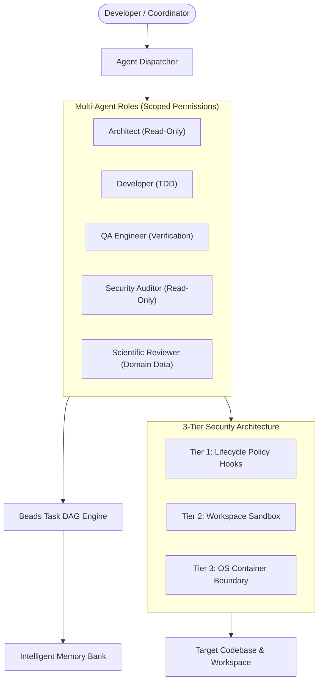
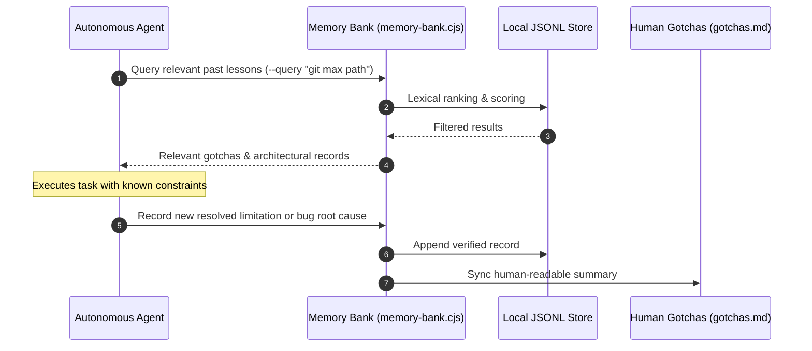
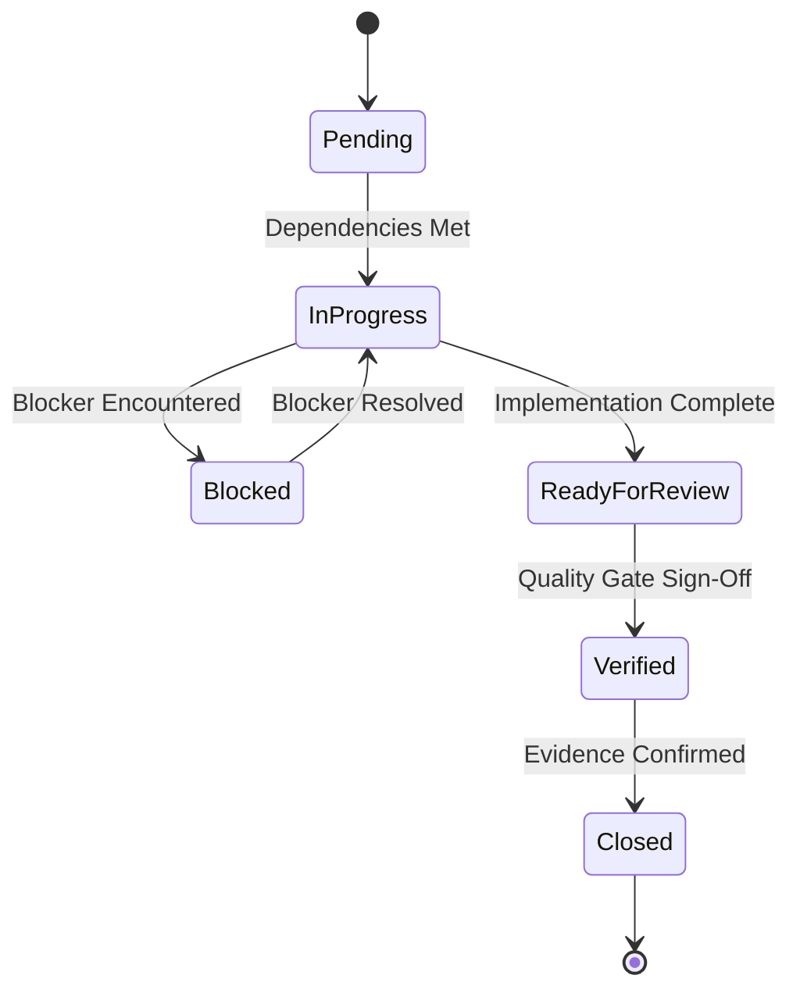
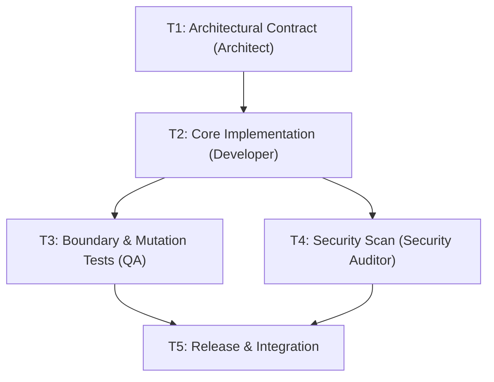
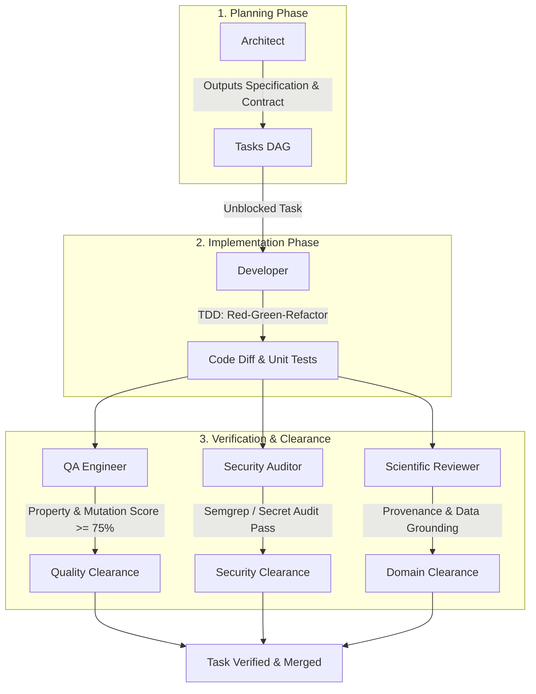
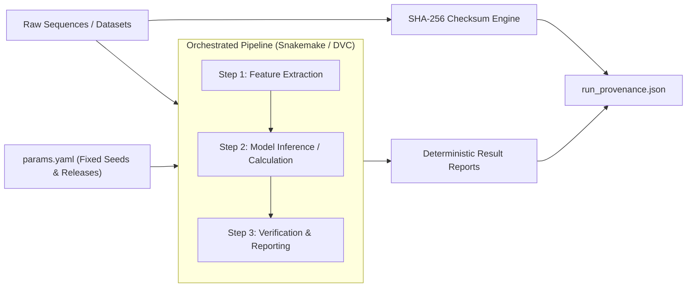
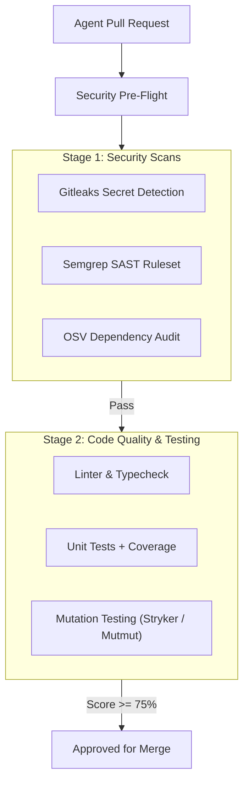

# Autonomous Agent Engineering Harness

A structured engineering architecture for autonomous coding agents, providing lifecycle policy enforcement, persistent cross-session memory, durable task dependency tracking, specialized multi-agent coordination, and computational provenance.

---

## 1. System Overview

Most AI coding setups suffer from context window degradation, unbounded tool permissions, and unverified code generation. This harness establishes deterministic control layers around agent execution.



---

## 2. Three-Tier Security Model

Lifecycle hooks provide early intent checks, while sandboxes and virtualization provide hard isolation.

```mermaid
flowchart LR
    subgraph T1["Tier 1: Intent & Policy Hooks"]
        H1["hooks.json"]
        H2["pre-tool-guard.cjs"]
        H3["post-tool-audit.cjs"]
    end

    subgraph T2["Tier 2: Agent Sandbox"]
        S1["Workspace File Boundaries"]
        S2["Default Egress Restriction"]
    end

    subgraph T3["Tier 3: Container / OS Boundary"]
        C1["Docker / DevContainer"]
        C2["Resource Limits (cgroups)"]
        C3["Read-Only System Mounts"]
    end

    ToolReq["Agent Tool Request"] --> T1
    T1 -- Allowed --> T2
    T2 -- Sandboxed Run --> T3
    T3 --> OS["Operating System"]
```



- **Tier 1 (Policy Hooks):** Inspects incoming tool commands before execution. Blocks credential reads (SSH keys, system stores) and requests confirmation for destructive file deletions and forced history rewrites.
- **Tier 2 (Harness Sandbox):** Constrains standard execution to designated workspaces and blocks untracked outbound network requests.
- **Tier 3 (Container Isolation):** Restricts physical memory, CPU usage, and filesystem access via container namespaces and non-root users.

---

## 3. Persistent Memory System

Agents frequently lose historical context between sessions. The memory bank provides indexed cross-session discovery without third-party API dependencies.



---

## 4. Durable Task Management (DAG Engine)

Context window compaction causes loss of active planning state. The task engine tracks a persistent Directed Acyclic Graph (DAG) in `tasks.json`.



### Dependency Resolution Workflow



- Tasks cannot be picked up until all prerequisite dependencies reach `closed` or `verified` status.
- Tasks cannot be marked `closed` without recorded verification evidence.

---

## 5. Multi-Agent Coordination & Boundaries

Unrestricted agents create chaotic edits. Clear roles establish separation of concerns.



| Role | Permissions | Responsibilities |
| :--- | :--- | :--- |
| **Architect** | Read-Only | System structure, typed interface contracts, task DAG generation. |
| **Developer** | Workspace Write | Surgical edits, test-first implementations, minimal code changes. |
| **QA Engineer** | Tests Directory Write | Property-based testing, boundary edge-cases, mutation scoring. |
| **Security Auditor** | Read-Only | Static security analysis, secret scanning, dependency CVE audits. |
| **Scientific Reviewer** | Science Tooling | Database cross-referencing, biological/chemical validation. |
| **Debugger** | Read-Only / Repro | Root-cause tracing, minimal isolated reproduction test cases. |
| **Performance Engineer** | Profiling Tools | Bottleneck analysis, memory leak audits, complexity debloating. |

---

## 6. Scientific Reproducibility & Provenance

For computational biology, chemistry, and data pipelines, reproducibility requires deterministic tracking.



- **Database Anchoring:** Enforces exact release versions (e.g. UniProt, ChEMBL, AlphaFold) rather than dynamic endpoints.
- **Data Hashing:** Tracks SHA-256 signatures of all input files and intermediate features.
- **Fixed Seeds:** Enforces deterministic configuration across execution runs.

---

## 7. Automated CI/CD Quality Pipeline

Every proposed change passes automated multi-stage verification before merging.



---

## 8. Directory Organization

```text
.
├── .github/
│   ├── workflows/agent-pipeline.yml   # Multi-stage CI/CD workflow
│   └── pull_request_template.md       # Evidence-driven PR review template
├── agents/                            # Role definitions and permissions matrix
│   ├── ROLES_AND_BOUNDARIES.md        # Master delegation matrix
│   └── *.md                           # Individual agent prompts
├── hooks/                             # Lifecycle policy guards
│   ├── hooks.json                     # PreToolUse / PostToolUse bindings
│   ├── pre-tool-guard.cjs             # Credential & command filter
│   └── post-tool-audit.cjs            # Secret leakage inspector
├── memory/                            # Cross-session knowledge persistence
│   ├── memory-bank.cjs                # Memory query and storage engine
│   └── memory-bank.jsonl              # Persistent memory log
├── tasks/                             # Context-loss resilient DAG engine
│   └── beads-tracker.cjs              # Dependency tracker and graph visualizer
├── observability/                     # Session trace telemetry and port allocator
│   ├── trace-analyzer.cjs             # Transcript step & error parser
│   └── port-guard.ps1                 # Local port registry & conflict preventer
├── rules/                             # Curated operational guidelines
│   └── GEMINI.md                      # Unified engineering standard
├── templates/                         # Reproducible configuration templates
│   ├── sandbox/                       # Docker & DevContainer isolation
│   ├── git-security/                  # Pre-commit & secret config
│   ├── testing/                       # Property and mutation test setups
│   └── science-provenance/            # Snakemake, DVC, and provenance scripts
└── tests/
    └── run-audit.cjs                  # Runtime verification test runner
```

---

## 9. Quickstart Guide

### 1. Initialize Task Graph
```bash
node tasks/beads-tracker.cjs init --project "my-project"
node tasks/beads-tracker.cjs add --id "T1" --title "Core Contract" --role "architect"
node tasks/beads-tracker.cjs next
```

### 2. Query Project Memory
```bash
node memory/memory-bank.cjs recall --query "port allocation"
```

### 3. Record a Discovered Gotcha
```bash
node memory/memory-bank.cjs record \
  --project "my-project" \
  --category "api_gotcha" \
  --title "Header Encoding Issue" \
  --content "Upstream proxy requires explicit Latin-1 header encoding." \
  --verified
```

### 4. Run Self-Verification
```bash
node tests/run-audit.cjs
```


---

## 10. Upstream Lineage, Integrated Repositories & Skill Suites

This harness synthesizes and refines concepts, workflows, and tools from leading open-source agent ecosystems:

### Core Engineering & Methodology Repositories

1. **[obra/superpowers](https://github.com/obra/superpowers)** (Jesse Vincent)
   - *Core Philosophy:* Disciplined software engineering methodology for autonomous agents.
   - *Integrated Skills:* `brainstorming`, `writing-plans`, `executing-plans`, `test-driven-development`, `systematic-debugging`, `subagent-driven-development`, `using-git-worktrees`, `verification-before-completion`, `requesting-code-review`, `receiving-code-review`.

2. **[addyosmani/agent-skills](https://github.com/addyosmani/agent-skills)** (Addy Osmani)
   - *Core Philosophy:* Production-grade engineering patterns that prevent agents from making unconstrained code modifications.
   - *Integrated Skills:* `context-engineering`, `planning-and-task-breakdown`, `frontend-ui-engineering`, `performance-optimization`, `spec-driven-development`, `code-simplification`, `api-and-interface-design`, `observability-and-instrumentation`, `security-and-hardening`, `shipping-and-launch`.

3. **[DietrichGebert/ponytail](https://github.com/DietrichGebert/ponytail)** (Dietrich Gebert)
   - *Core Philosophy:* Lazy Senior Developer Mode (v5.3.3) — "the best code is the code never written". Shortest working diffs, zero speculative wrappers, deletion over addition.
   - *Integrated Skills:* `ponytail`, `ponytail-review`, `ponytail-audit`, `ponytail-debt`, `ponytail-gain`.

4. **[vaibhav-space/my-ai-coding-workflow](https://github.com/vaibhav-space/my-ai-coding-workflow)** (Vaibhav)
   - *Core Philosophy:* Three-phase architecture and review process (`1-planning.md`, `2-critical-plan-review.md`, `3-production-readiness-review.md`), interactive HTML plan rendering (`plan-template.html`), and human-curated failure mode logs (`gotchas.md`).

5. **[abdoabdo22334456-prog/how-did-i-make-my-antigravity-faster](https://github.com/abdoabdo22334456-prog/how-did-i-make-my-antigravity-faster)**
   - *Core Philosophy:* Runtime performance, background process management, RAM mitigation, and port collision defense (`port-guard.ps1`, `local-ports-registry.json`).

6. **[promptfoo/promptfoo](https://github.com/promptfoo/promptfoo)**
   - *Core Philosophy:* Deterministic evaluations and regression benchmarks for LLM coding agents.
   - *Integrated Assets:* `evals/promptfoo.yaml` (benchmarking diff minimalism, credential safety, TDD adherence).

7. **[rohitg00/agentmemory](https://github.com/rohitg00/agentmemory) & [mem0ai/mem0](https://github.com/mem0ai/mem0)**
   - *Core Philosophy:* Persistent cross-session agent memory without vendor lock-in.
   - *Integrated Implementation:* `memory/memory-bank.cjs` providing local zero-API TF-IDF retrieval and two-way sync with human-readable gotchas.

8. **[e2b-dev/E2B](https://github.com/e2b-dev/E2B)**
   - *Core Philosophy:* Secure isolated execution environments and sandboxing for autonomous coding agents.
   - *Integrated Assets:* Docker sandbox templates with 4GB cgroups limits and non-root execution (`Dockerfile.sandbox`, `devcontainer.json`).

9. **[yusufkaraaslan/Skill_Seekers](https://github.com/yusufkaraaslan/Skill_Seekers)**
   - *Core Philosophy:* Automated documentation scraping and dynamic skill extraction from libraries and APIs (`skill-builder`, `skill-audit`).

---

### Google DeepMind Science Suite (Computational Biology & Chemistry)

Derived from the Google DeepMind Science ecosystem (`google-deepmind/science-skills`), providing direct database integration, structural biology tools, and bioinformatics pipelines:

* **Structural Biology & Protein Analysis:**
  - `alphafold-database-fetch-and-analyze`: Fetch and analyze AlphaFold predicted 3D structures and pLDDT scores.
  - `biomolecular-structure-viewer`: Interactive 3D molecular structure visualizer via Mol*.
  - `pdb-database`: Query and download RCSB Protein Data Bank experimental 3D structures.
  - `uniprot-database`: Comprehensive protein sequence, domain, taxonomy, and function annotations.
  - `pymol`: Scripted 3D structural alignment, contact analysis, and publication-ready rendering.
  - `foldseek-structural-search`: Fast 3D structural similarity searches.
  - `interpro-database` & `human-protein-atlas-database`: Protein family domains and spatial expression.

* **Genomics, Variant Impact & Regulatory Biology:**
  - `alphagenome-single-variant-analysis`: Deep learning predictions of variant effects on gene expression, chromatin, and histone marks.
  - `alphagenome-variant-impact-score`: AVI functional impact scores, saturation mutagenesis scans.
  - `alphagenome-atlas-website-links`: Deep links to genomic coordinates on AlphaGenome Atlas.
  - `dbsnp-database`, `clinvar-database`, `gnomad-database`, `ensembl-database`: Variant pathogenicity, allele frequencies, and gene transcript maps.
  - `jaspar-database`, `unibind-database`, `encode-ccres-database`, `gtex-database`: Transcription factor motifs, regulatory elements, and eQTL expression.

* **Cheminformatics & Drug Discovery:**
  - `chembl-database` & `pubchem-database`: Bioactive compounds, binding affinities (IC50, Ki), and chemical structures.
  - `cheminformatics-core`, `cheminformatics-ml`, `cheminformatics-physics`, `cheminformatics-reactions`: RDKit physicochemical descriptors, QSAR models, 3D conformers, and reaction retrosynthesis.
  - `reactome-database`, `string-database`, `openfda-database`, `clinical-trials-database`: Pathway enrichment, PPI networks, FDA adverse events, and NCT trials.

* **Scientific Literature & Provenance:**
  - `literature-search-pubmed`, `literature-search-biorxiv`, `literature-search-arxiv`, `literature-search-europepmc`, `literature-search-openalex`: Verified scientific literature retrieval.
  - `provenance_tracker.py`, `Snakefile.template`, `dvc.yaml.template`: Snakemake pipelines, SHA-256 dataset hashing, and experiment parameter tracking.
