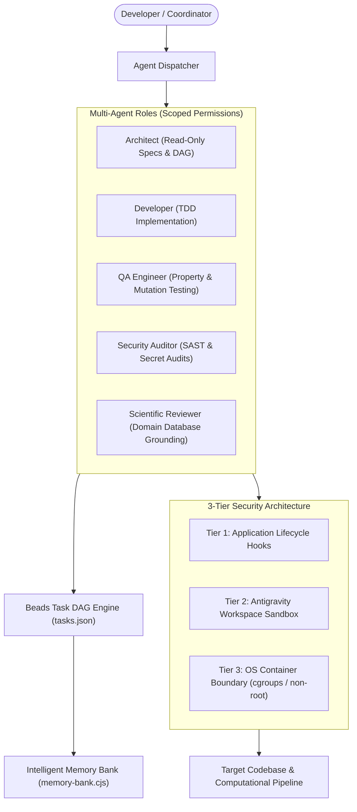
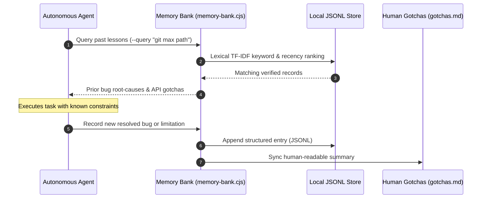
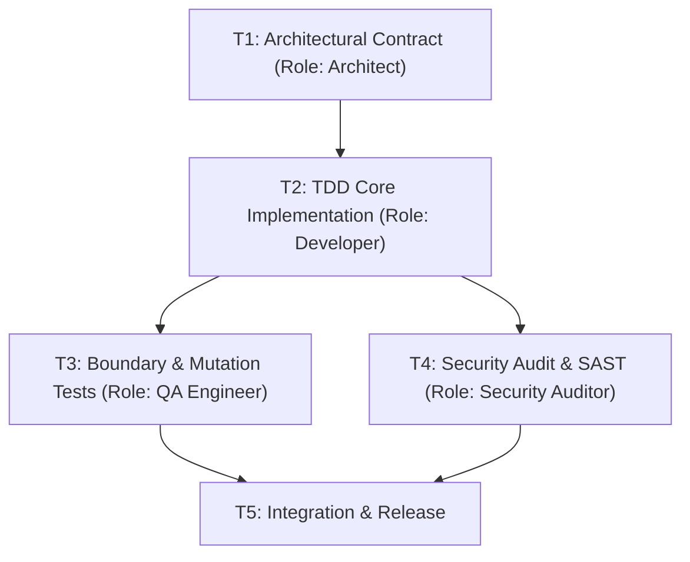
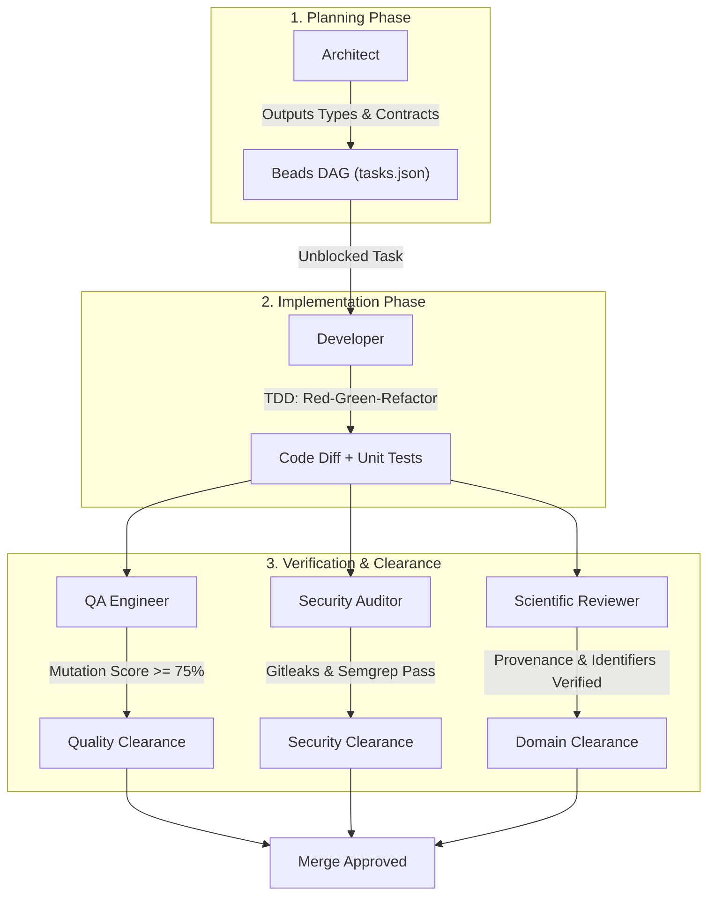
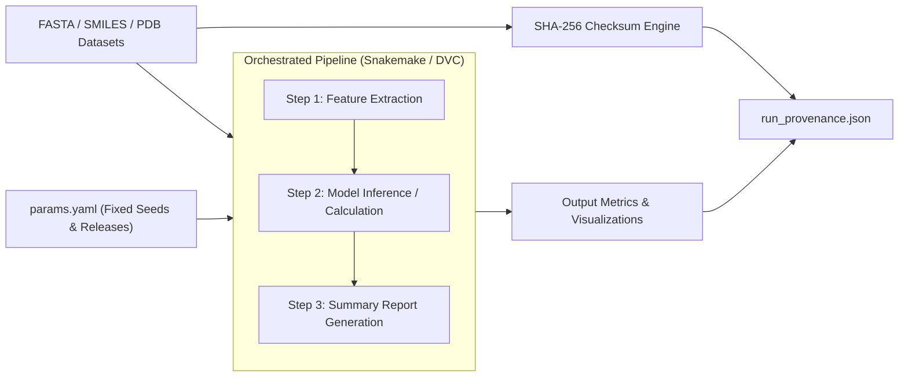
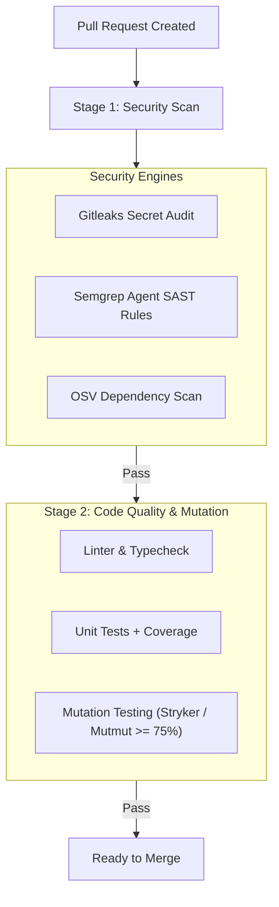

# Antigravity Elite Agent Engineering Harness

[](https://github.com/SamDozer/antigravity-elite-harness/actions)
[](SECURITY_ARCHITECTURE.md)
[](tests/run-audit.cjs)
[](templates/testing/TESTING_STRATEGY.md)
[](LICENSE)

A production-grade engineering architecture and runtime governance harness for autonomous AI coding agents. Provides **3-tier security boundaries**, **deterministic persistent memory**, **Beads DAG task scheduling**, **strict role-based agent coordination (RBAB)**, and **cryptographic scientific provenance**.

---

## Table of Contents
1. [Why Most AI Coding Setups Fail in Production](#1-why-most-ai-coding-setups-fail-in-production)
2. [The Comparative Paradigm Matrix](#2-the-comparative-paradigm-matrix)
3. [System Architecture](#3-system-architecture)
4. [The Three-Tier Security Model](#4-the-three-tier-security-model)
5. [Persistent Cross-Session Memory (AgentMemory / Mem0)](#5-persistent-cross-session-memory-agentmemory--mem0)
6. [Beads DAG Task Engine (Context-Loss Recovery)](#6-beads-dag-task-engine-context-loss-recovery)
7. [Role-Based Agent Boundaries (RBAB)](#7-role-based-agent-boundaries-rbab)
8. [Scientific Reproducibility & Computational Biology](#8-scientific-reproducibility--computational-biology)
9. [Automated CI/CD, SAST & Advanced Mutation Testing](#9-automated-cicd-sast--advanced-mutation-testing)
10. [End-to-End Walkthroughs](#10-end-to-end-walkthroughs)
11. [Failure Modes & Anti-Pattern Defense Catalog](#11-failure-modes--anti-pattern-defense-catalog)
12. [Quickstart & Installation](#12-quickstart--installation)
13. [Upstream Lineage & Credits](#13-upstream-lineage--credits)

---

## 1. Why Most AI Coding Setups Fail in Production

When developers first experiment with AI coding agents, they typically install dozens of prompt instruction files ("skills"). Under production workloads, this unstructured setup breaks down into five fatal failure modes:

| Fatal Failure Mode | Root Cause in Naive Setups | Impact on Codebases |
| :--- | :--- | :--- |
| **1. The Context Cliff** | Multi-turn chat context expands past 80k+ tokens. Early requirements and contracts are truncated or forgotten. | Agents contradict earlier decisions, hallucinate API structures, and generate expensive token churn. |
| **2. The Green-Test Illusion** | Agents optimize for a green test runner status code rather than correctness. | Agents quietly delete failing test assertions, skip tests, or add `@ts-ignore` to fake success. |
| **3. Speculative Code Bloat** | Agents generate large abstract boilerplate architectures to anticipate hypothetical futures. | A 10-line pure function gets ballooned into 500 lines across 6 nested files with redundant interfaces. |
| **4. Security Blindness** | Agents have unconstrained tool permissions and zero execution isolation. | Leaks private keys (`~/.ssh`), executes unverified `curl \| sh`, or destroys Git histories with forced pushes. |
| **5. Scientific Nondeterminism** | Computational biology and scientific tasks require immutable database versions and strict seeds. | Agents hallucinate accession numbers, flip measurement units ($nM$ vs $\mu M$), and run unseeded stochastic workflows. |

**This harness solves each of these failure modes through structural, code-enforced boundaries.**

---

## 2. The Comparative Paradigm Matrix

| Engineering Dimension | Naive Agent Setup | Instruction-Heavy Setup | **Antigravity Elite Harness** |
| :--- | :--- | :--- | :--- |
| **Cross-Session Memory** | None (Goldfish memory). Forgets resolved bugs when session closes. | Static markdown notes that must be manually read. | **Intelligent Local Memory Bank** (`memory-bank.cjs`) with TF-IDF keyword ranking and automated two-way sync with `gotchas.md`. |
| **Task State Management** | Kept in conversational memory. Wiped out upon context compaction. | Loose markdown bullet lists easily hallucinated or skipped. | **Beads Directed Acyclic Graph** (`beads-tracker.cjs`) stored deterministically on disk. Automated ready-queue resolution. |
| **Tool Execution Safety** | Unrestricted shell execution. Can delete systems or leak keys. | Text-only instructions ("please do not delete files"). Ignored under pressure. | **Three-Tier Defense:** Fast lifecycle hooks (`pre-tool-guard.cjs`) $\to$ Process Sandbox $\to$ Docker cgroups limits. |
| **Code Modification Style** | Rewrites entire files; breaks imports and formatting. | Adds large speculative boilerplate for future edge-cases. | **Ponytail v5.3.3 & Surgical Coder:** Shortest working diff, deletion beats addition, zero speculative wrappers. |
| **Quality Verification** | Trust developer claims ("all tests should pass"). | Runs basic `npm test` without checking if tests assert anything. | **Universal Quality Gate:** Strict TDD + Property-Based Fuzzing (`fast-check`/`hypothesis`) + Mutation Testing (`stryker`/`mutmut`). |
| **Computational Biology** | Hallucinates sequences, ungrounded citations, random seeds. | Static instructions without data verification. | **Scientific Provenance Layer:** Snakemake pipeline, SHA-256 dataset hashing, fixed seeds, DeepMind science integration. |

---

## 3. System Architecture



---

## 4. The Three-Tier Security Model

Lifecycle hooks run inside the agent harness process. If a hook times out or throws, agent runners may fail open to prevent deadlock. True defense requires physical isolation:

```mermaid
flowchart LR
    subgraph T1["Tier 1: Intent & Policy Hooks"]
        H1["hooks.json"]
        H2["pre-tool-guard.cjs"]
        H3["post-tool-audit.cjs"]
    end

    subgraph T2["Tier 2: Antigravity Sandbox"]
        S1["Workspace File Boundaries"]
        S2["Default Egress Restriction"]
    end

    subgraph T3["Tier 3: OS Container Boundary"]
        C1["Docker / DevContainer"]
        C2["Resource Limits (4GB RAM cgroup)"]
        C3["Read-Only System Mounts"]
    end

    ToolReq["Agent Tool Call"] --> T1
    T1 -- "Allow Tool" --> T2
    T2 -- "Subshell Run" --> T3
    T3 --> OS["Host Operating System"]
```



### IPC Hook Specification
Antigravity executes `hooks/pre-tool-guard.cjs` before tool dispatch by piping JSON over `stdin`:
```json
{
  "toolCall": {
    "name": "run_command",
    "args": { "CommandLine": "cat ~/.ssh/id_rsa" }
  }
}
```
The hook outputs the decision to `stdout`:
```json
{
  "decision": "deny",
  "reason": "HARD SECURITY GATE: Access to private SSH keys and Windows system credential stores is strictly blocked."
}
```
- `decision: "allow"`: Tool proceeds to sandbox.
- `decision: "deny"`: Execution aborted; explanation returned to agent turn.
- `decision: "force_ask"`: Execution paused; user prompted for explicit human authorization.

---

## 5. Persistent Cross-Session Memory (AgentMemory / Mem0)

AI agents typically forget everything when a chat ends. The Memory Bank (`memory/memory-bank.cjs`) provides deterministic, cross-session discovery without requiring paid third-party embeddings:



### CLI Reference:
```bash
# Record a new discovery or resolved bug
node memory/memory-bank.cjs record \
  --project "my-project" \
  --category "api_gotcha" \
  --title "PowerShell UTF-8 BOM" \
  --content "New-Object UTF8Encoding $false prevents Node.js syntax errors." \
  --tags "powershell,utf8,bom" \
  --verified

# Recall relevant memories for current context
node memory/memory-bank.cjs recall --query "UTF-8 BOM Node.js" --project "my-project"

# Sync between structured JSONL and human gotchas.md
node memory/memory-bank.cjs sync-gotchas --project-dir ./
```

---

## 6. Beads DAG Task Engine (Context-Loss Recovery)

When conversations exceed 50 steps, context compaction summarizes earlier turns and destroys the agent's mental model of what tasks remain. 

The Beads engine stores a Directed Acyclic Graph (DAG) in `tasks.json` on disk:



### Key Guarantees:
1. **Dependency Resolution:** `node tasks/beads-tracker.cjs next` returns ONLY tasks whose dependencies are marked `closed` or `verified`.
2. **Mandatory Evidence:** A task cannot be marked `closed` without recorded verification evidence (`--evidence "..."`).
3. **Mermaid Visualization:** Run `node tasks/beads-tracker.cjs graph` to render live diagrams.

---

## 7. Role-Based Agent Boundaries (RBAB)

Autonomous agents fail when every agent has unrestricted write access. RBAB establishes strict separation of duties:



| Agent Role | Permissions | Mandate & Constraints |
| :--- | :--- | :--- |
| **Architect** | **Read-Only** | Decomposes systems into typed interface contracts and Beads task DAGs. Prohibited from touching production code. |
| **Developer** | **Workspace Write** | Surgical TDD implementation (Red $\to$ Green $\to$ Refactor). Prohibited from altering architecture or self-certifying tests. |
| **QA Engineer** | **Tests Directory Write** | Universal Quality Gate. Writes property-based and mutation tests. Prohibited from modifying production application files. |
| **Security Auditor** | **Read-Only** | Independent SAST (Semgrep), credential audits (Gitleaks), and CVE scans. Prohibited from editing code directly. |
| **Scientific Reviewer** | **Science Tooling** | UniProt/ChEMBL/AlphaFold database validation, unit sanity checks, citation verification. Prohibited from altering build infra. |
| **Debugger** | **Read-Only / Repro** | 4-Phase systematic root-cause tracing and minimal repro creation. Prohibited from speculative symptom-patching. |
| **Performance Engineer** | **Profiling Tools** | Memory leak audits, Core Web Vitals, SLOC debloating. Prohibited from introducing premature caching layers. |

---

## 8. Scientific Reproducibility & Computational Biology

AI agents frequently hallucinate in biomedical domains by inventing sequence accessions, switching units ($nM$ vs $\mu M$), or using unpinned API endpoints. This harness enforces scientific provenance:



- **Snakemake Pipelines:** Chained execution rules in `Snakefile.template`.
- **DVC Dataset Hashing:** Tracks data files across preprocessing and model evaluation stages.
- **Deterministic Provenance Tracker:** `provenance_tracker.py` hashes all inputs with SHA-256 and captures software versions and platform metadata.

---

## 9. Automated CI/CD, SAST & Advanced Mutation Testing

Unit tests can achieve 100% coverage without verifying correctness if assertions are weak. This harness integrates **Mutation Testing** (Stryker / Mutmut) and **Property-Based Testing** (`fast-check` / `hypothesis`):



### Mutants vs Tests
Mutation testing automatically injects synthetic faults into agent-written code:
- If tests **fail**, the mutant is **killed** (Test suite is strong).
- If tests **pass**, the mutant **survives** (Test suite is weak).
- **Target Gate:** Minimum **75% mutant kill rate** required before merging.

---

## 10. End-to-End Walkthroughs

Explore the [examples/](examples/) directory for complete, runnable projects:

### A. Fullstack Auth Module ([examples/fullstack-auth](examples/fullstack-auth))
- **`tasks.json`:** Beads DAG demonstrating the 4-phase handover from Architect $\to$ Developer $\to$ QA $\to$ Security Auditor.
- **`src/token.ts`:** Surgical JWT token signer and verifier adhering to Ponytail v5.3.3.
- **`gotchas.md`:** Documented lesson regarding constant-time string comparisons.

### B. Computational Biology Pipeline ([examples/computational-biology](examples/computational-biology))
- **`params.yaml`:** Pinned target accession (`P38398` - BRCA1), fixed random seed (`42`), and database releases.
- **`Snakefile`:** Multi-step reproducible pipeline.
- **`sample_provenance.json`:** Immutable execution record containing SHA-256 signatures of inputs and environment dependencies.

---

## 11. Failure Modes & Anti-Pattern Defense Catalog

| Failure Anti-Pattern | How Agents Fail in the Wild | Harness Structural Defense |
| :--- | :--- | :--- |
| **The Test Deletion Anti-Pattern** | Agent encounters a failing test, deletes or comments it out, and claims success. | **RBAB & CI Pipeline:** Developer cannot modify tests; QA controls tests; CI enforces coverage & mutation score thresholds. |
| **The Scope Creep Trap** | Agent adds 400 lines of speculative options nobody asked for. | **Ponytail v5.3.3 Rule:** "Shortest working diff wins. No speculative wrappers. Deletion beats addition." |
| **The Goldfish Loop** | Agent hits the same framework gotcha repeatedly across 10 sessions. | **Memory Bank:** `node memory/memory-bank.cjs recall` retrieves past solutions and gotchas before debugging begins. |
| **Port Collision Lockup** | Agent spins up dev servers on busy ports, hangs, or crashes. | **Port Allocation Guard:** `observability/port-guard.ps1` maintains an active registry of assigned localhost ports. |
| **Secret Leaks in Git** | Agent writes API keys into code or commits `.env`. | **Pre-Tool & CI Audit:** `hooks/post-tool-audit.cjs` blocks writes; Gitleaks scans git history on pre-commit and CI. |

---

## 12. Quickstart & Installation

### Step 1: Clone and Run Self-Verification
```bash
git clone https://github.com/SamDozer/antigravity-elite-harness.git
cd antigravity-elite-harness
node tests/run-audit.cjs
```

### Step 2: Initialize a Project Task Graph
```bash
node tasks/beads-tracker.cjs init --project "my-service"
node tasks/beads-tracker.cjs add --id "T1" --title "API Interface Contract" --role "architect"
node tasks/beads-tracker.cjs next
```

### Step 3: Recall Past Lessons
```bash
node memory/memory-bank.cjs recall --query "JWT verification"
```

---

## 13. Upstream Lineage & Credits

This harness synthesizes and refines core concepts from:
- **[obra/superpowers](https://github.com/obra/superpowers)** (Disciplined engineering methodology, TDD, debugging)
- **[google-deepmind/science-skills](https://github.com/google-deepmind/science-skills)** (Genomics, AlphaFold, UniProt, ChEMBL)
- **[addyosmani/agent-skills](https://github.com/addyosmani/agent-skills)** (Context engineering, task breakdown, interface design)
- **[DietrichGebert/ponytail](https://github.com/DietrichGebert/ponytail)** (Lazy Senior Dev mode v5.3.3, minimal diffs)
- **[vaibhav-space/my-ai-coding-workflow](https://github.com/vaibhav-space/my-ai-coding-workflow)** (Plan review protocols, gotchas documentation)
- **[rohitg00/agentmemory](https://github.com/rohitg00/agentmemory)** & **[mem0ai/mem0](https://github.com/mem0ai/mem0)** (Persistent agent memory)
- **[promptfoo/promptfoo](https://github.com/promptfoo/promptfoo)** (Deterministic LLM agent evals)
- **[e2b-dev/E2B](https://github.com/e2b-dev/E2B)** (Agent container sandboxing)
