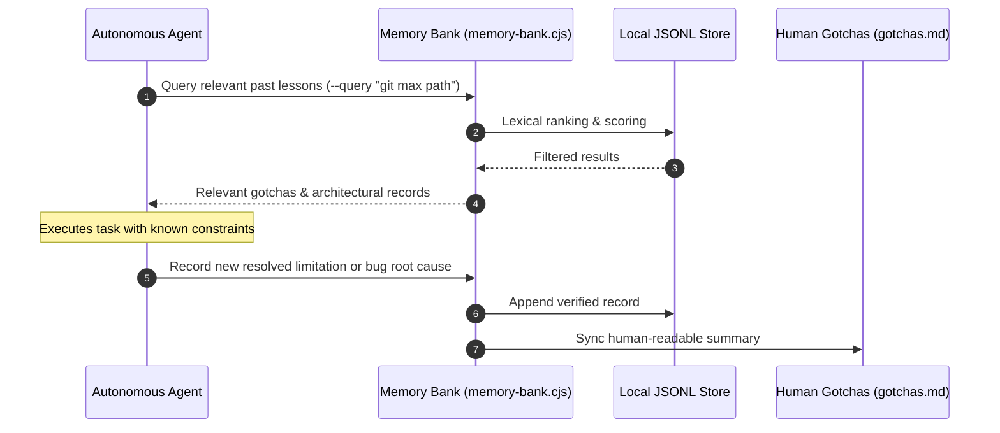
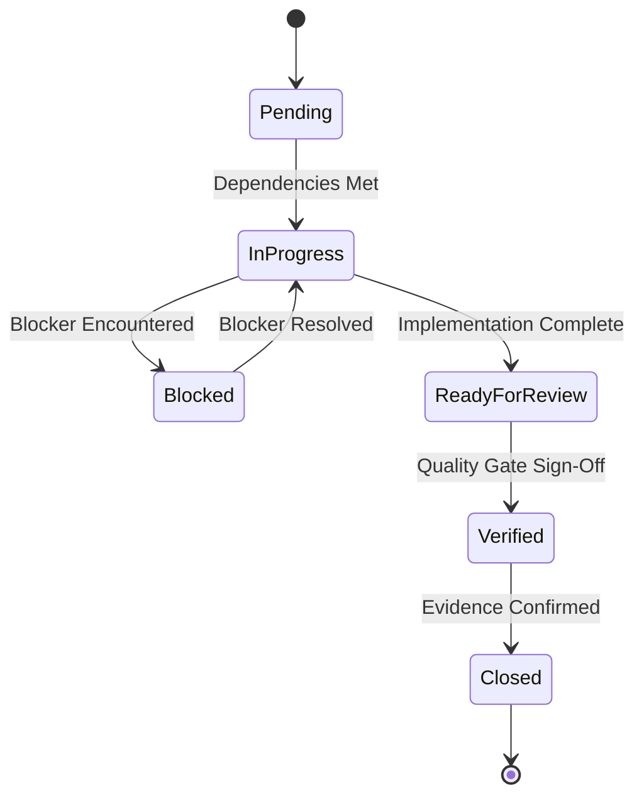
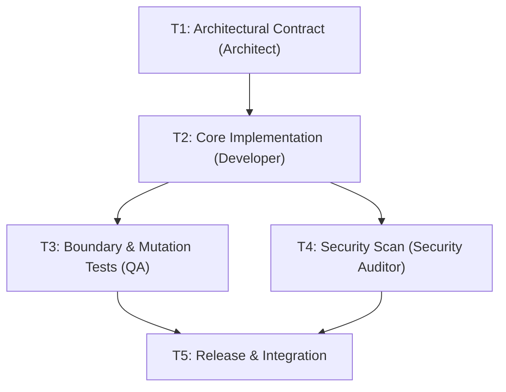
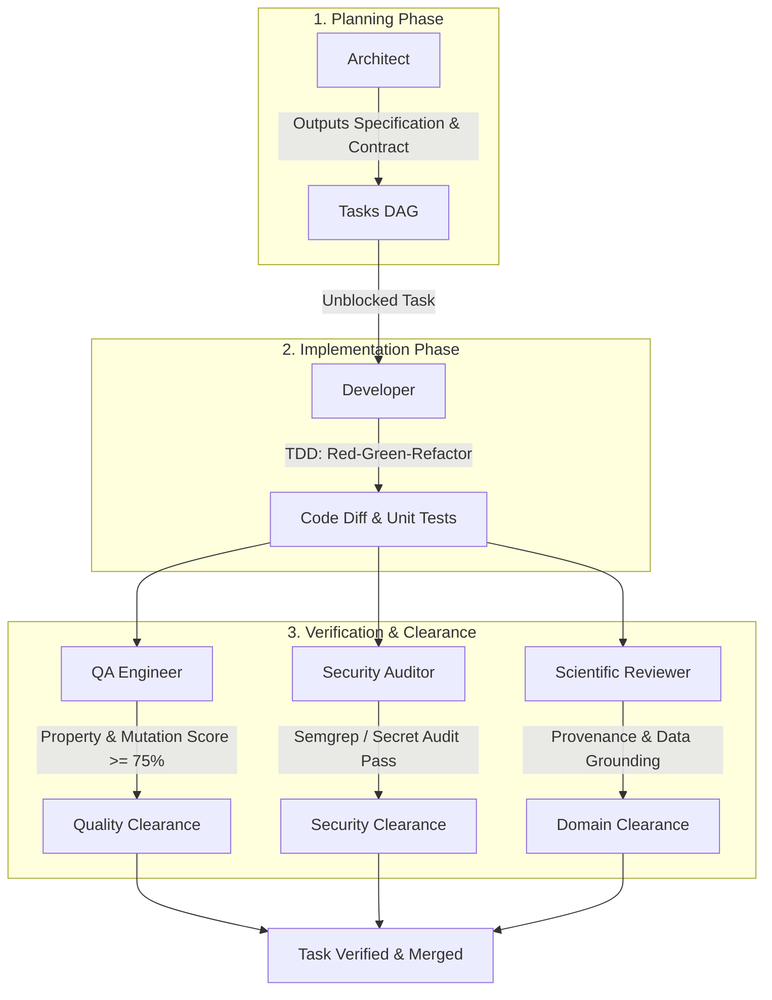
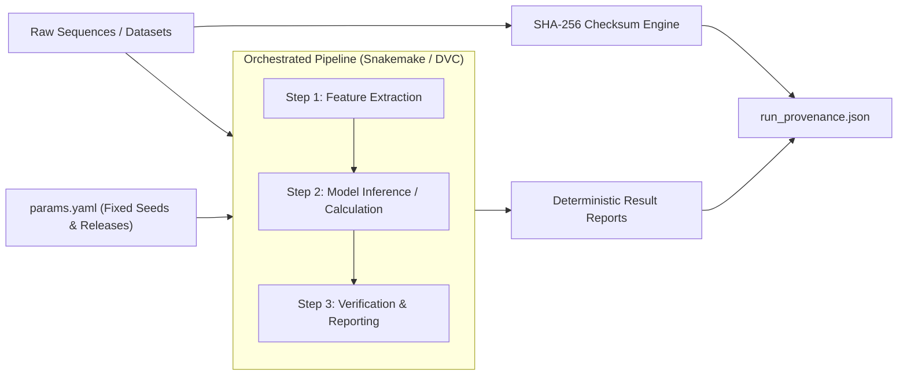
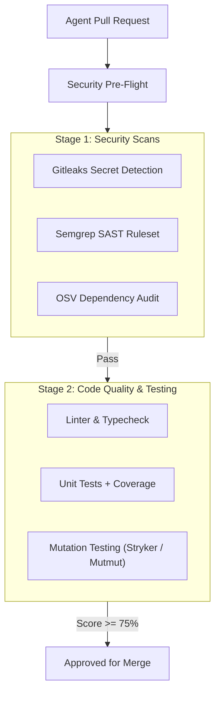

# Autonomous Agent Engineering Harness

A structured engineering architecture for autonomous coding agents, providing lifecycle policy enforcement, persistent cross-session memory, durable task dependency tracking, specialized multi-agent coordination, and computational provenance.

---

## 1. System Overview

Most AI coding setups suffer from context window degradation, unbounded tool permissions, and unverified code generation. This harness establishes deterministic control layers around agent execution.


---

## 2. Three-Tier Security Model

Lifecycle hooks provide early intent checks, while sandboxes and virtualization provide hard isolation.

```mermaid
flowchart LR
    subgraph T1["Tier 1: Intent & Policy Hooks"]
        H1["hooks.json"]
        H2["pre-tool-guard.cjs"]
        H3["post-tool-audit.cjs"]
    end

    subgraph T2["Tier 2: Agent Sandbox"]
        S1["Workspace File Boundaries"]
        S2["Default Egress Restriction"]
    end

    subgraph T3["Tier 3: Container / OS Boundary"]
        C1["Docker / DevContainer"]
        C2["Resource Limits (cgroups)"]
        C3["Read-Only System Mounts"]
    end

    ToolReq["Agent Tool Request"] --> T1
    T1 -- Allowed --> T2
    T2 -- Sandboxed Run --> T3
    T3 --> OS["Operating System"]
```



- **Tier 1 (Policy Hooks):** Inspects incoming tool commands before execution. Blocks credential reads (SSH keys, system stores) and requests confirmation for destructive file deletions and forced history rewrites.
- **Tier 2 (Harness Sandbox):** Constrains standard execution to designated workspaces and blocks untracked outbound network requests.
- **Tier 3 (Container Isolation):** Restricts physical memory, CPU usage, and filesystem access via container namespaces and non-root users.

---

## 3. Persistent Memory System

Agents frequently lose historical context between sessions. The memory bank provides indexed cross-session discovery without third-party API dependencies.



---

## 4. Durable Task Management (DAG Engine)

Context window compaction causes loss of active planning state. The task engine tracks a persistent Directed Acyclic Graph (DAG) in `tasks.json`.



### Dependency Resolution Workflow



- Tasks cannot be picked up until all prerequisite dependencies reach `closed` or `verified` status.
- Tasks cannot be marked `closed` without recorded verification evidence.

---

## 5. Multi-Agent Coordination & Boundaries

Unrestricted agents create chaotic edits. Clear roles establish separation of concerns.



| Role | Permissions | Responsibilities |
| :--- | :--- | :--- |
| **Architect** | Read-Only | System structure, typed interface contracts, task DAG generation. |
| **Developer** | Workspace Write | Surgical edits, test-first implementations, minimal code changes. |
| **QA Engineer** | Tests Directory Write | Property-based testing, boundary edge-cases, mutation scoring. |
| **Security Auditor** | Read-Only | Static security analysis, secret scanning, dependency CVE audits. |
| **Scientific Reviewer** | Science Tooling | Database cross-referencing, biological/chemical validation. |
| **Debugger** | Read-Only / Repro | Root-cause tracing, minimal isolated reproduction test cases. |
| **Performance Engineer** | Profiling Tools | Bottleneck analysis, memory leak audits, complexity debloating. |

---

## 6. Scientific Reproducibility & Provenance

For computational biology, chemistry, and data pipelines, reproducibility requires deterministic tracking.



- **Database Anchoring:** Enforces exact release versions (e.g. UniProt, ChEMBL, AlphaFold) rather than dynamic endpoints.
- **Data Hashing:** Tracks SHA-256 signatures of all input files and intermediate features.
- **Fixed Seeds:** Enforces deterministic configuration across execution runs.

---

## 7. Automated CI/CD Quality Pipeline

Every proposed change passes automated multi-stage verification before merging.



---

## 8. Directory Organization

```text
.
├── .github/
│   ├── workflows/agent-pipeline.yml   # Multi-stage CI/CD workflow
│   └── pull_request_template.md       # Evidence-driven PR review template
├── agents/                            # Role definitions and permissions matrix
│   ├── ROLES_AND_BOUNDARIES.md        # Master delegation matrix
│   └── *.md                           # Individual agent prompts
├── hooks/                             # Lifecycle policy guards
│   ├── hooks.json                     # PreToolUse / PostToolUse bindings
│   ├── pre-tool-guard.cjs             # Credential & command filter
│   └── post-tool-audit.cjs            # Secret leakage inspector
├── memory/                            # Cross-session knowledge persistence
│   ├── memory-bank.cjs                # Memory query and storage engine
│   └── memory-bank.jsonl              # Persistent memory log
├── tasks/                             # Context-loss resilient DAG engine
│   └── beads-tracker.cjs              # Dependency tracker and graph visualizer
├── observability/                     # Session trace telemetry and port allocator
│   ├── trace-analyzer.cjs             # Transcript step & error parser
│   └── port-guard.ps1                 # Local port registry & conflict preventer
├── rules/                             # Curated operational guidelines
│   └── GEMINI.md                      # Unified engineering standard
├── templates/                         # Reproducible configuration templates
│   ├── sandbox/                       # Docker & DevContainer isolation
│   ├── git-security/                  # Pre-commit & secret config
│   ├── testing/                       # Property and mutation test setups
│   └── science-provenance/            # Snakemake, DVC, and provenance scripts
└── tests/
    └── run-audit.cjs                  # Runtime verification test runner
```

---

## 9. Quickstart Guide

### 1. Initialize Task Graph
```bash
node tasks/beads-tracker.cjs init --project "my-project"
node tasks/beads-tracker.cjs add --id "T1" --title "Core Contract" --role "architect"
node tasks/beads-tracker.cjs next
```

### 2. Query Project Memory
```bash
node memory/memory-bank.cjs recall --query "port allocation"
```

### 3. Record a Discovered Gotcha
```bash
node memory/memory-bank.cjs record \
  --project "my-project" \
  --category "api_gotcha" \
  --title "Header Encoding Issue" \
  --content "Upstream proxy requires explicit Latin-1 header encoding." \
  --verified
```

### 4. Run Self-Verification
```bash
node tests/run-audit.cjs
```
