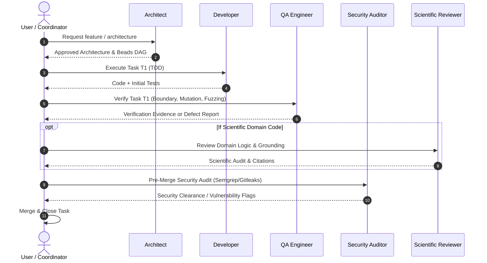

# Antigravity Multi-Agent Orchestration & Permission Boundary Matrix

## 1. Orchestration Philosophy & Governance
Autonomous agent development fails when every agent is given unrestricted read/write permissions and operates without role separation. 
Antigravity enforces strict **Role-Based Agent Boundaries (RBAB)**:
1. **Architects plan, but never touch production code.**
2. **Developers implement approved specifications, but never self-certify security or quality.**
3. **QA Engineers write tests and break implementations, but never rewrite application logic.**
4. **Security Auditors inspect code and dependencies, but never modify code directly.**
5. **Scientific Reviewers validate domain accuracy, databases, and units, but never alter infrastructure.**

---

## 2. Agent Roster & Permission Boundaries

| Agent Name | Primary Responsibility | Permitted Tools / Capabilities | Strictly Forbidden Actions |
| :--- | :--- | :--- | :--- |
| **Architect** | High-level system design, module decomposition, API contracts, Beads DAG setup. | Read files, web search, diagramming, memory bank recall. | Cannot write/edit production source files, cannot execute mutating shell commands. |
| **Developer** | Surgical TDD implementation, minimal diffs, unit test creation. | Read/write workspace files, run local unit tests, linter checks. | Cannot bypass sandbox without permission, cannot alter security rules, cannot force push git. |
| **Researcher** | API documentation lookup, paper synthesis, external package exploration. | Search web, read docs, read repository files. | Cannot write or edit code, cannot execute shell commands outside readonly doc tools. |
| **Debugger** | Root-cause tracing, stack trace analysis, minimal repro creation. | Read source, run test cases, inspect trace logs. | Cannot apply speculative symptom-patches (`if` band-aids). Must formulate a falsifiable hypothesis. |
| **QA Engineer** | Comprehensive quality gate, property-based tests, mutation testing, edge-case probing. | Read source, write/edit in `tests/`, run test runners and coverage suites. | Cannot edit production application files. Cannot lower test coverage or delete failing assertions. |
| **Security Auditor**| SAST scan, credential leak detection, OWASP Top 10 check, supply-chain analysis. | Read source, run Semgrep, Gitleaks, OSV-Scanner, npm/pip audit. | Cannot modify source files directly. Produces remediation reports with exact line citations. |
| **Performance Engineer** | Profiling, memory leak detection, SLOC debloating, bundle size analysis. | Read source, run benchmarks, heap profilers, bundle analyzers. | Cannot introduce complex premature caching abstractions without benchmark proof. |
| **Scientific Reviewer** | Biological/chemical validation, UniProt/ChEMBL/AlphaFold database cross-check, citation verification. | Read source, call Science MCP tools, search PubMed/arXiv/EuropePMC. | Cannot invent scientific claims, cannot fabricate UniProt IDs, cannot approve ungrounded literature citations. |

---

## 3. Handover Protocol & Quality Gates

### Gate 1: Architecture to Implementation
- The **Architect** must produce:
  1. Module boundary specifications with explicit typed interfaces.
  2. A Beads task graph (`tasks.json`) where every task has defined inputs, outputs, and acceptance criteria.
  3. Memory bank check for existing architectural gotchas.

### Gate 2: Implementation to QA
- The **Developer** must provide:
  1. Strict TDD evidence (Red $\to$ Green $\to$ Refactor).
  2. Minimal diffs adhering to Ponytail v5.3.3.
  3. Passing local unit tests without any `@ts-ignore`, `eslint-disable`, or skipped tests.

### Gate 3: QA & Security Clearance to Completion
- The **QA Engineer** and **Security Auditor** must independently execute:
  1. Property/mutation test checks (e.g. minimum 80% mutation score).
  2. Zero high/critical findings in Semgrep and Gitleaks scans.
  3. Concrete runtime verification evidence recorded in the Beads task graph.
