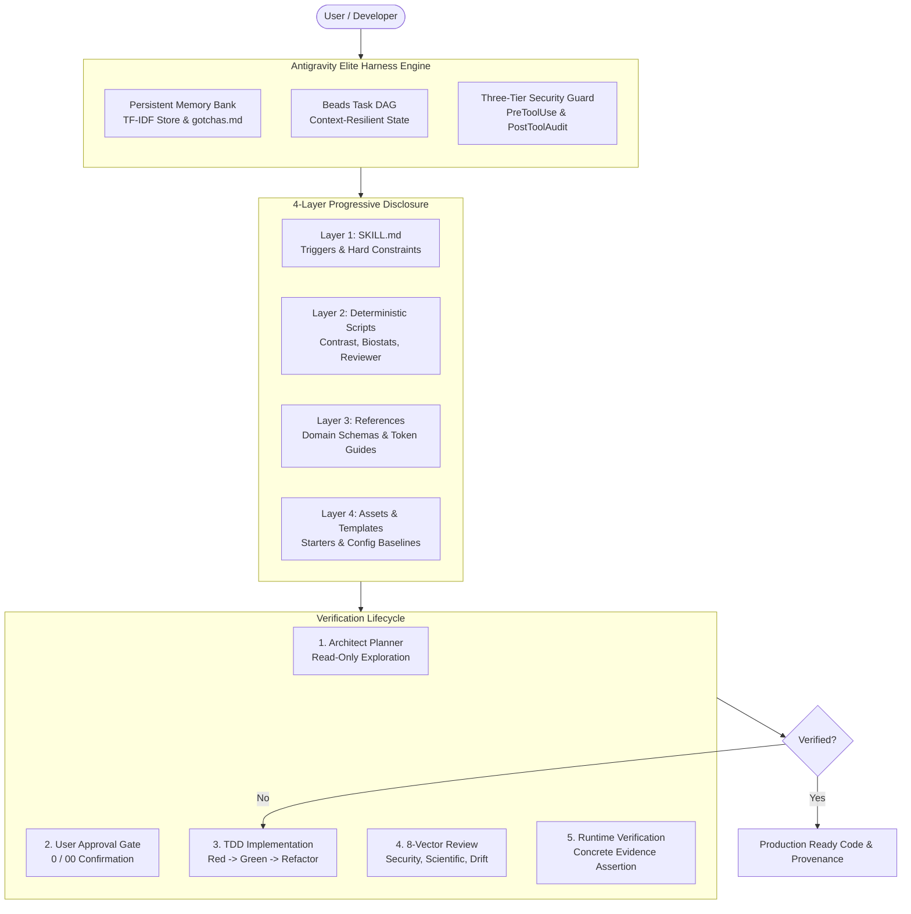
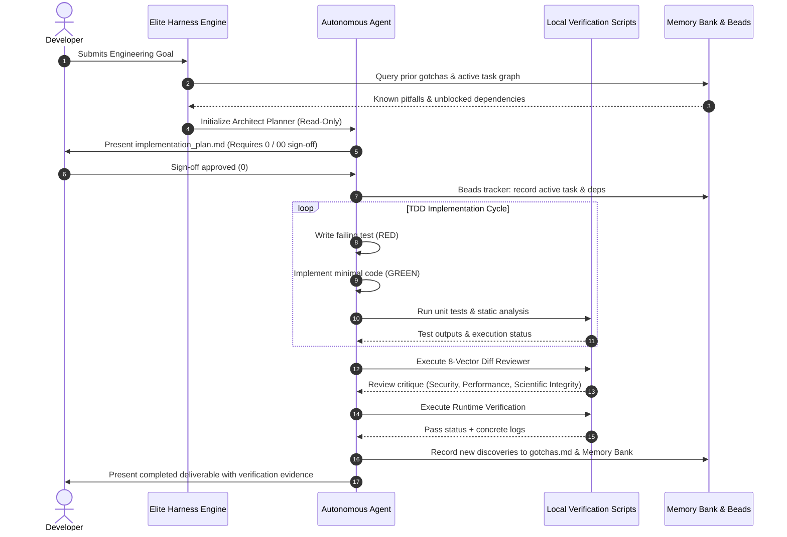

# System Architecture & Engineering Specifications

This document outlines the architecture, failure modes, design trade-offs, and execution lifecycle of the **Antigravity Elite AI Engineering Harness**.

---

## 1. Executive System Overview

The Antigravity Elite Harness transforms generic LLM interactions into an autonomous, deterministic, and verifiable engineering environment. Rather than relying on monolithic system prompts, it couples lightweight behavioral contracts with deterministic local scripts, context-resilient task tracking, cross-session memory, and multi-tier security defenses.



---

## 2. The 5 Core Failure Modes of Prompt-Only Harnesses

Traditional AI coding harnesses rely almost exclusively on extensive system prompts and single-file Markdown rule collections. In production environments, prompt-only systems consistently encounter five structural failure modes:

| Failure Mode | Root Cause | Failure Manifestation | Harness Solution |
| :--- | :--- | :--- | :--- |
| **1. Context Amnesia & Token Exhaustion** | Injecting thousands of lines of instructions on every turn | Context exhaustion, degraded reasoning, lost system instructions halfway through complex tasks | Single ultra-lean operational rule (`rules/global-core.md` < 1k tokens) + on-demand progressive disclosure |
| **2. Hallucinated Self-Verification** | Asking models to self-certify whether code works ("did you test it?") | Model answers "Yes, all tests pass" without executing anything | Deterministic CLI verification (`scripts/visual_audit.mjs`, `review_diff.py`, `validate_pdb.py`) |
| **3. Cross-Domain Token Bleed** | Vague skill descriptions lacking negative trigger boundaries | Computational biology skills fire during React tasks; CSS guides load during Python backend tasks | Strict frontmatter triggers with mandatory `Use when` AND `Do NOT use when` clauses |
| **4. False Security Equivalence** | Assuming application hooks provide operating-system level boundaries | Agent processes bypass hook filters if hooks fail open or run into timeouts | Three-Tier Defense: App hooks (Tier 1), Process Sandbox (Tier 2), Docker/cgroups (Tier 3) |
| **5. Task Drift & Scope Creep** | Keeping task lists only in active conversation context | Context summarization strips away pending items, leading to abandoned edge cases | File-backed Beads Task DAG (`tasks/beads-tracker.cjs`) resilient to context compaction |

---

## 3. Comparative Architecture Matrix

| Dimension | Prompt-Only Harnesses (Cursor Rules, Basic Prompts) | Heavy Frameworks (AutoGPT, CrewAI, LangGraph) | Antigravity Elite Harness |
| :--- | :--- | :--- | :--- |
| **Base Token Overhead** | 10k–30k tokens loaded on every turn | 15k–40k tokens + large framework schemas | **< 1,000 tokens** always-on; skills load on demand |
| **Verification Basis** | Model self-assertion ("Looks good to me") | Multi-agent debate loops (expensive token burn) | **Deterministic local CLI scripts** and runtime test execution |
| **Task State Management** | Active conversational history (ephemeral) | In-memory Python runtime or external database | **Local JSON DAG engine (`tasks/beads-tracker.cjs`)** |
| **Security Enforcement** | Prompt pleading ("Please do not delete files") | Network proxy or API wrapper | **Three-Tier model** with AST hook inspection + sandbox + Docker |
| **Domain Portability** | Web development only | Generic abstractions | **Modular domains**: Core, Frontend UI, and Computational Biology |
| **Installation Footprint** | Manual copy-pasting | Heavy pip/poetry environments with dozens of dependencies | **Native shell installers** (`install.sh`, `install.ps1`) with profile selection |

---

## 4. 4-Layer Progressive Disclosure Architecture

To maximize intelligence while minimizing token expenditure, every skill in this harness follows a strict 4-layer separation:

```
skills/<domain>/<skill-name>/
├── SKILL.md            # Layer 1: Trigger rules, workflow steps, hard constraints (< 350 lines)
├── scripts/            # Layer 2: Deterministic executables (Python / Node.js)
├── references/         # Layer 3: Deep domain schemas, lookup tables, specifications
└── assets/             # Layer 4: Copyable starter templates and configuration files
```

### Layer 1: Operational Contract (`SKILL.md`)
Contains strictly the operational workflow, trigger boundaries, and hard constraints. Must remain under 350 lines to prevent context degradation.

### Layer 2: Deterministic Verification Scripts (`scripts/`)
Eliminates model guesswork. Whenever a mathematical calculation, AST inspection, contrast check, or file validation is required, the model executes a script instead of calculating in prose.

### Layer 3: On-Demand Domain References (`references/`)
Loaded into context only when a specific subtask requires deep reference data (e.g., WCAG token contrast tables, SLURM partition flags, bioinformatic database schemas).

### Layer 4: Starter Templates & Assets (`assets/`)
Production-vetted templates (e.g., `pub_style.mplstyle`, `slurm_template.sh`) that the agent copies into projects, eliminating boilerplate generation from scratch.

---

## 5. End-to-End Execution Lifecycle



This structured lifecycle ensures that every line of code produced by the agent is designed, reviewed against 8 explicit engineering vectors, and validated through real runtime execution before completion.
