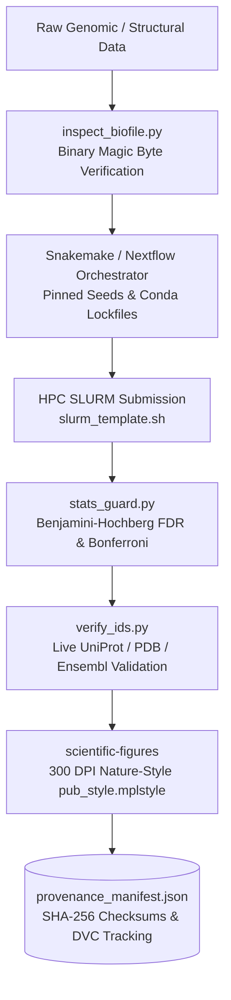

# Computational Biology Workflows & Cryptographic Provenance

This document outlines the scientific integrity guardrails, bioinformatics pipelines, and reproducibility architecture implemented in the **Antigravity Elite AI Engineering Harness**.

---

## 1. The Reproducibility Crisis in Scientific AI Coding

AI models frequently fail when generating scientific workflows:
1. **Uncorrected P-Values:** Reporting raw p-values across thousands of genomic tests without FDR (False Discovery Rate) correction.
2. **Hallucinated Database Accessions:** Citing fabricated UniProt IDs, non-existent PDB structures, or false PubMed references.
3. **Corrupted Binary Parsing:** Treating binary molecular dynamics trajectories (`.xtc`), matrix files (`.npy`), or AnnData files (`.h5ad`) as plain UTF-8 text.
4. **Non-Reproducible Pipeline Execution:** Missing random seeds, unpinned Conda environments, and missing data checksums.

The Elite Harness resolves these issues through **6 modular computational biology skills** and deterministic verification scripts.



---

## 2. Computational Biology Skill Suite

### 1. `bio-orchestrator`
* **Trigger:** Complex multi-step bioinformatic pipelines, workflow execution, large dataset parsing.
* **Deterministic Tool:** `scripts/inspect_biofile.py`
  * Reads file headers using binary magic bytes (`\x93NUMPY`, `1995` for XTC, `\x89HDF` for H5AD/AnnData).
  * Prevents catastrophic memory crashes by streaming metadata rather than loading multi-gigabyte matrices into Python memory.

### 2. `structural-bio-md`
* **Trigger:** Protein structures, AlphaFold models, molecular dynamics simulations (OpenMM, GROMACS).
* **Deterministic Tool:** `scripts/validate_pdb.py`
  * Parses PDB and mmCIF coordinate records.
  * Calculates per-residue pLDDT confidence scores.
  * Flags disordered regions ($pLDDT < 50$) and warns against rigid docking into low-confidence loops.

### 3. `bio-sequence-stats`
* **Trigger:** Differential expression, GWAS variant association, statistical hypothesis testing.
* **Deterministic Tool:** `scripts/stats_guard.py`
  * Automatically applies Benjamini-Hochberg FDR and Bonferroni corrections to multiple comparisons.
  * Rejects unadjusted p-values in genome-scale assays.
  * Computes Cohen's $d$ and odds ratios to ensure statistical significance is backed by meaningful biological effect sizes.

### 4. `hpc-containers-pipelines`
* **Trigger:** Cluster job submission, SLURM batch scripts, Singularity/Apptainer container definitions.
* **Starter Asset:** `assets/slurm_template.sh`
  * Standardized GPU (`--gres=gpu:a100:1`), memory, and partition parameters.
  * Automated job dependency chaining (`--dependency=afterok:<jobid>`).

### 5. `scientific-figures`
* **Trigger:** Publication-ready data visualization, manuscript figures.
* **Starter Asset:** `assets/pub_style.mplstyle`
  * Enforces Nature/Cell publication standards: 300+ DPI vector outputs, Helvetica/Arial typography, minimum 3:1 data mark contrast.
  * Strictly forbids dual-axis charts, 3D pie charts, and unscaled rainbow/jet colormaps.

### 6. `bio-literature-grounding`
* **Trigger:** Resolving or citing biological database identifiers in code or documentation.
* **Deterministic Tool:** `scripts/verify_ids.py`
  * Queries official REST endpoints (NCBI E-utilities, UniProt REST, RCSB PDB, Ensembl).
  * Rejects hallucinated protein, gene, or structure identifiers with exit code `1`.
  * Caches verified lookups locally to enable offline verification.

---

## 3. Cryptographic Provenance Architecture

To guarantee scientific reproducibility across computing clusters and publication revisions, the harness produces an immutable `provenance_manifest.json` for all pipeline outputs:

```json
{
  "pipeline": "variant_calling_pipeline_v1",
  "timestamp": "2026-11-20T07:15:00Z",
  "deterministic_seed": 42,
  "inputs": [
    {
      "path": "data/samples/sample_01.cram",
      "sha256": "e3b0c44298fc1c149afbf4c8996fb92427ae41e4649b934ca495991b7852b855",
      "dvc_hash": "a82f8d39c01"
    }
  ],
  "environment": {
    "conda_lock": "environment.lock.yml",
    "singularity_sha": "d41d8cd98f00b204e9800998ecf8427e"
  },
  "outputs": [
    {
      "path": "results/filtered_variants.vcf.gz",
      "sha256": "7d793037a0760186574b0282f2f435e7",
      "fdr_threshold_applied": 0.05
    }
  ]
}
```

By enforcing cryptographic verification at every step, the harness guarantees that results generated with AI assistance meet the highest standards of scientific rigor.
