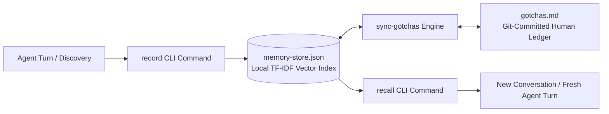
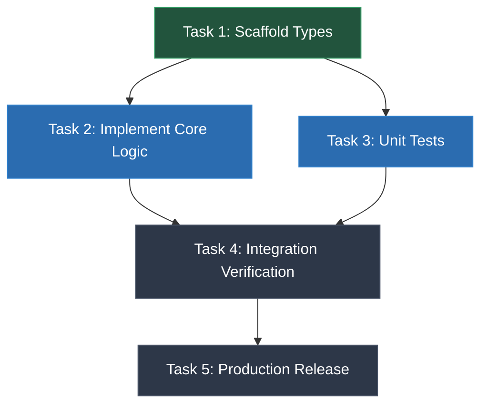

# Persistent Memory Bank & Beads Task DAG Engine

This document details the cross-session knowledge persistence and context-resilient task tracking mechanisms used by the **Antigravity Elite AI Engineering Harness**.

---

## 1. Cross-Session Persistent Memory (`memory-bank.cjs`)

When an AI agent operates across dozens of distinct conversations, critical lessons are frequently lost:
* Undocumented API quirks and rate limits
* Hardware or compiler flags required for local builds
* Workarounds discovered during painful debugging sessions

The harness provides `memory/memory-bank.cjs`, a local, zero-external-dependency memory engine that indexes project discoveries using lightweight TF-IDF retrieval and synchronizes with human-readable markdown (`gotchas.md`).



### Memory CLI Reference

#### 1. Record a New Discovery
Records an architectural decision, tricky bug root-cause, or external API limitation:
```bash
node memory/memory-bank.cjs record \
  --project "my-app" \
  --category "api-gotcha" \
  --title "Stripe Webhook Idempotency Header" \
  --content "Stripe-Signature header must be verified with raw body buffer before JSON body-parser executes."
```

#### 2. Recall Relevant Knowledge
Performs TF-IDF similarity search to retrieve knowledge matching the current task context:
```bash
node memory/memory-bank.cjs recall --query "stripe webhook body raw"
```

#### 3. Synchronize with `gotchas.md`
Translates structured JSON memory into clean, version-controlled markdown for team visibility:
```bash
node memory/memory-bank.cjs sync-gotchas
```

#### 4. View Memory Bank Statistics
```bash
node memory/memory-bank.cjs stats
```

---

## 2. Context-Resilient Task Management (`beads-tracker.cjs`)

### The Problem: Ephemeral Context Amnesia
In long, multi-turn engineering tasks, LLM context windows undergo compaction and summarization. Ephemeral markdown checklists stored in prompt history are routinely truncated or forgotten, causing agents to drop pending edge cases, repeat completed work, or declare success prematurely.

### The Solution: The Beads DAG Pattern
`tasks/beads-tracker.cjs` maintains a deterministic, dependency-directed task graph stored on disk (`.beads-dag.json`). Tasks cannot be completed without providing concrete runtime verification evidence, and dependent tasks remain blocked until their prerequisites are closed.



### Beads CLI Reference

#### 1. Initialize a Project Task Graph
```bash
node tasks/beads-tracker.cjs init
```

#### 2. Add Tasks with Dependencies
```bash
# Add base task
node tasks/beads-tracker.cjs add --id "T1" --title "Define database schema and migrations"

# Add dependent task (blocked until T1 closes)
node tasks/beads-tracker.cjs add --id "T2" --title "Implement user auth service" --deps "T1"
```

#### 3. Query the Next Actionable Task
Returns only tasks whose dependencies are 100% satisfied:
```bash
node tasks/beads-tracker.cjs next
```

#### 4. Close a Task with Verification Evidence
Rejects closure if verification evidence is missing:
```bash
node tasks/beads-tracker.cjs close \
  --id "T1" \
  --evidence "Ran prisma migrate dev; verified SQLite tables created cleanly in 14ms."
```

#### 5. Inspect DAG Status & Render ASCII Graph
```bash
node tasks/beads-tracker.cjs status
node tasks/beads-tracker.cjs graph
```

---

## 3. Best Practices for Developers & Agents

1. **Query Memory First:** At the beginning of any debugging or architecture session, query the memory bank with keywords from the error or feature spec.
2. **Never Close Beads Without Proof:** Closure mandates passing runtime command outputs. Statements like "looks good" or "should work" are strictly rejected by harness rules.
3. **Commit `gotchas.md`:** Check `gotchas.md` into git version control so human developers and team agents share a single source of operational truth.
