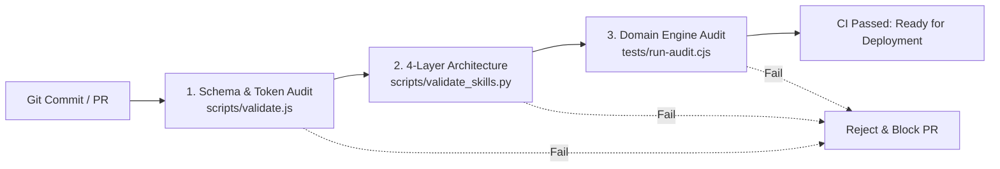

# Role-Based Agent Boundaries (RBAB) & CI/CD Pipeline

This specification outlines the specialized agent roles, permission boundaries, CI/CD quality gates, and anti-pattern mitigations implemented in the **Antigravity Elite AI Engineering Harness**.

---

## 1. Role-Based Agent Boundaries (RBAB)

### The Problem: Monolithic Agent Privileges
When a single agent prompt possesses unrestricted read, write, and shell execution capabilities, failure modes escalate rapidly: architects run destructive deletions during exploration, developers self-certify security audits, and reviewers approve unverified code.

### The Solution: Explicit Least-Privilege Roles
The harness partitions tasks across 8 specialized agent profiles with strict tool permissions:

| Agent Role | Primary Focus | File Read | File Write | Shell Execution | Sandbox Bypass |
| :--- | :--- | :---: | :---: | :---: | :---: |
| **1. System Architect** | System design, trade-offs, architecture docs | ✅ | ❌ *(docs only)* | ❌ | ❌ |
| **2. Lead Developer** | TDD implementation, surgical bug fixes | ✅ | ✅ | ✅ *(sandboxed)* | ❌ |
| **3. QA / Verification** | Boundary fuzzing, mutation tests, runtime checks | ✅ | ✅ *(tests only)* | ✅ *(sandboxed)* | ❌ |
| **4. Security Auditor** | SAST analysis, credential & dependency audits | ✅ | ❌ | ❌ | ❌ |
| **5. DevOps / HPC** | Containers, SLURM scripts, CI/CD workflows | ✅ | ✅ | ✅ | ⚠️ *(review)* |
| **6. Computational Biologist**| Pipeline orchestration, scientific data integrity | ✅ | ✅ | ✅ *(sandboxed)* | ❌ |
| **7. UI/UX Engineer** | Design tokens, WCAG 2.2 AA accessibility | ✅ | ✅ | ✅ *(browser/node)* | ❌ |
| **8. Diff Reviewer** | 8-vector pull request review & regression check| ✅ | ❌ | ❌ | ❌ |

---

## 2. CI/CD Automated Verification Pipeline

Every contribution to this harness must pass a multi-stage automated validation pipeline before being merged:

### CI Pipeline Stage Summary
1. **Schema & Token Budget Gate (`scripts/validate.js`):**
   * Validates `plugin.json` schema and event hooks.
   * Asserts every operational rule in `rules/` stays under the 15.0 KB budget limit.
   * Verifies zero unpinned network runtime downloads inside hook scripts.
2. **4-Layer Skill Architecture Gate (`scripts/validate_skills.py`):**
   * Validates all 13 skills conform to progressive disclosure: `SKILL.md` (< 350 lines), `scripts/`, `references/`, and `assets/`.
   * Enforces explicit `Use when` AND `Do NOT use when` clauses in every frontmatter description.
3. **Comprehensive Runtime Verification (`tests/run-audit.cjs`):**
   * Validates `memory-bank.cjs` record, TF-IDF recall, and stats calculations.
   * Tests `beads-tracker.cjs` DAG initialization, dependency resolution, and closure blocks.
   * Verifies `pre-tool-guard.cjs` security filters (allowing safe commands, blocking credential access, requiring confirmation on destructive operations).
   * Validates domain tools (`visual_audit.mjs`, `stats_guard.py`, `slurm_template.sh`, `review_diff.py`).

---

## 3. Catalog of 10 Agent Anti-Patterns & Harness Mitigations

| Anti-Pattern | Description | How Elite Harness Eliminates It |
| :--- | :--- | :--- |
| **1. The Rubber-Stamping Yes-Man** | Agent confirms user assumptions without checking facts or tests. | Independent Quality Gate rules + doubt-driven development posture. |
| **2. Speculative Over-Abstraction** | Agent introduces unnecessary generics, wrappers, and config factories. | Ponytail minimalism: deletion beats addition; shortest working diff wins. |
| **3. Context Dumping** | Injecting entire manuals and frameworks on every turn. | Progressive disclosure: core rule < 1k tokens; domain skills load on demand. |
| **4. Silent Error Masking** | Wrapping code in empty `try/catch` blocks to pass tests. | Static analysis flags empty catch blocks; requires explicit root-cause logging. |
| **5. "Should Work" Flakiness** | Declaring completion based on theoretical correctness without running it. | Universal Quality Gate: zero completion claims accepted without runtime output. |
| **6. Fragile Regex File Parsing** | Reading binary science or binary data formats as UTF-8 strings. | Dedicated binary inspect tools (`inspect_biofile.py`) inspecting magic bytes. |
| **7. Secret Leakage** | Committing `.env` tokens, AWS keys, or reading `~/.ssh`. | `pre-tool-guard.cjs` blocks credential reading and scanning tools catch leaks. |
| **8. Destructive Shell Actions** | Accidentally running `rm -rf /` or forced branch overwrites. | AST shell interception forces explicit user interactive approval (`ASK`). |
| **9. Mental Arithmetic in Prose** | Calculating currency, quotas, or p-values conversationally. | Mandatory code execution rule: arithmetic must be calculated in Python/Node. |
| **10. Non-Reproducible Pipelines** | Writing bioinformatic scripts without pinned seeds or container configs. | `bio-orchestrator` mandates Conda lockfiles, SHA-256 hashes, and deterministic seeds. |
