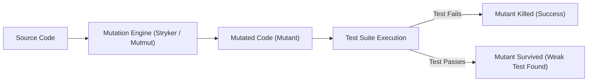

# Advanced Testing & Quality Gate Strategy

## 1. Why Line Coverage Is Not Enough
A standard unit test suite can achieve 100% code coverage without verifying that the code is correct. For example, a test that calls a function without making strong assertions executes every line but catches zero bugs.

To achieve production reliability in AI-agent environments, Antigravity introduces two advanced testing layers:
1. **Mutation Testing (Testing the Tests):** Injects synthetic bugs (mutants) into the code to verify that the test suite actually fails.
2. **Property-Based Testing (Testing Invariants):** Generates hundreds of pseudo-random, edge-case inputs to search for boundary failures and shrinks failing inputs to minimal examples.

---

## 2. Tools & Standards

| Tool | Ecosystem | Purpose | Recommended Gate Threshold |
| :--- | :--- | :--- | :--- |
| **Stryker Mutator** | TypeScript / JS | Mutation Testing | $\ge 75\%$ Mutation Score |
| **fast-check** | TypeScript / JS | Property-Based Fuzzing | 100+ randomized iterations |
| **Mutmut** | Python | Mutation Testing | $\ge 75\%$ Mutation Score |
| **Hypothesis** | Python | Property-Based Fuzzing | 100+ randomized iterations |

---

## 3. Workflow for QA Engineers

1. **Write Property Tests for Pure Functions:** Identify algebraic properties:
   - *Roundtrip:* `deserialize(serialize(x)) == x`
   - *Idempotence:* `fn(fn(x)) == fn(x)`
   - *Invariance:* `len(sort(list)) == len(list)`
2. **Run Mutation Analysis:**
   - Execute Stryker or Mutmut before merging critical features (auth, parsers, finance, calculation algorithms).
   - If mutants survive, add specific assertions to kill them.
